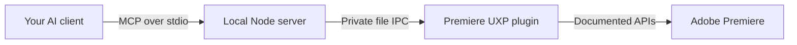

# Premiere MCP Bridge

**Give your AI agent a documented connection to Adobe Premiere.** Inspect timelines, work on sequence copies and build creative tools through local MCP—using the agent you choose.

Built by **YWD Agency** for editors, creative technologists and developers connecting AI workflows to desktop production tools. The bridge exposes explicit operations; you direct the edit. It does not choose a story, analyze footage for an automatic montage or replace editorial judgment.

[Client setup](docs/clients.md) · [Tools](docs/commands.md) · [Native API](docs/native-api.md) · [Troubleshooting](docs/troubleshooting.md) · [Documentation index](INDEX.md)

**Release candidate 0.3.8 — source preview.** Native checks use Premiere 26.5 on macOS Apple Silicon; manifest minimum is 25.6 and the server requires Node.js 22+. Windows host behavior is unverified. Installed 0.3.8 passes doctor, a ten-file batch, file-denial recovery, backup/edit/marker checks and readable XML/OTIO outputs. Earlier versioned tests cover persistence and clean lifecycle. The current Node budget is 30 seconds; use the matching updated checkout/client. Explicit source authorization, one-frame A/V editing, revocation and renewed protection also pass on an owner-approved synthetic fixture. Broader asset-dependent scenarios remain separately unverified. No downloadable installer release is published. See [current evidence](docs/release/native-check-0.3.8.md) and [release gates](docs/release/README.md).

## What you can do

Ask an agent to report the active sequence, inspect paginated clips with exact ticks/timecodes, or read existing transcript data where the host supports it. Prepare a named working copy and make deliberate clip, marker, effect or keyframe changes through documented tools. Develop a custom assistant that can discover exact native signatures and probe the installed runtime before calling them.

Timeline mutations default to sequences created or duplicated by this bridge in the current plugin session. With explicit owner instruction, `premiere_authorize_sequence` permits one existing sequence after a verified direct-clone backup; `premiere_revoke_sequence_authorization` removes that permission. Retained backups, original-sequence deletion and shared source media stay protected. Project saves, global settings, Source Monitor changes and native export jobs are separate, explicit operations with their own side effects. See [tools and arguments](docs/commands.md).

## Two components, one local connection

The **UXP plugin** runs inside Premiere. The **Node MCP server** is started by your AI client on the same computer and user account. They exchange bounded JSON in the plugin's private local storage; there is no bridge-folder picker, cloud bridge, API key or HTTP listener.



The client receives tool results, which may include project names, clip names and requested transcript text. Its model provider and data policies still apply. A local transport does not make the AI client offline. Read [security and data handling](SECURITY.md).

## Install and connect on macOS

The CCX route uses Adobe Creative Cloud's installer; end users do not need UXP
Developer Tools. See [CLI installation](docs/installation.md) and
[first-run agent instructions](docs/agent-quickstart.md).

**The candidate is not published yet.** For private review, use the matching
branch and independently reviewed local CCX/checksum:

```sh
git clone --branch release/0.3.6 https://github.com/ywdagency/premiere-uxp-bridge.git
cd premiere-uxp-bridge
npm ci
npm run onboard -- --ccx /path/to/reviewed.ccx --sha256 REVIEWED_HASH
# Once verified, repeat with --install --read-only to invoke Adobe and configure Codex.
```

Validation does not install or configure anything. Explicit --install creates
project-local Codex configuration; other clients receive JSON for manual merge.
Enable Premiere Developer Mode in Preferences → Plugins, open Window → UXP Plugins → Premiere MCP Bridge, and reconnect the client from this trusted clone. Then run `npm run doctor`. It requires the expected version and commands to be executing; installer success alone is insufficient. First-run client paths and remaining installation limits are recorded in the [final private review](docs/release/final-review-0.3.8.md).

After matching tagged source/assets are published,
`npm run onboard -- --release --install` downloads/checks the checkout's exact
release and installs/configures it. Missing releases fail, without a latest-version
fallback. The [installation guide](docs/installation.md) distinguishes this future
public route from today's local candidate; no public release exists yet.

## Development loading with UDT

Install Node.js 22+, Adobe Premiere 25.6+ and Adobe UXP Developer Tools (UDT). Adobe documents Premiere support from UDT 2.2; this project's developer-load shortcut was tested with UDT 2.3.0. Premiere 26.5 is the current native reference host. A working Adobe installation/license is required separately.

```sh
git clone --branch release/0.3.6 https://github.com/ywdagency/premiere-uxp-bridge.git
cd premiere-uxp-bridge
npm ci
npm run setup
```

Run commands from the clone. Until the repository becomes public, cloning requires access. Setup builds the plugin and creates this clone's ignored `.codex/config.toml` with absolute paths. It preserves unrelated Codex server entries, replaces this bridge's prior local registration and does not change global settings. For Claude Desktop, Cursor or VS Code, use [the client guide](docs/clients.md) instead of the default Codex setup.

In Premiere, enable Developer Mode in Preferences → Plugins if needed. In UDT, add this clone's `manifest.json` and select Load. With UDT and Premiere already running, `npm run plugin:load` is an optional development shortcut; manual UDT Load is the fallback. Open **Premiere MCP Bridge** under Window → UXP Plugins once to instantiate it.

Open this clone as a trusted project in Codex, then restart/reconnect its MCP server so the new configuration is read. No connection folder or address is required. For a first successful command, ask:

> Use `premiere_get_capabilities` and `premiere_get_project` with empty arguments. Tell me the host version and whether a project is open. Do not edit, activate, export or save anything.

Success means capabilities report the connected host and project inspection returns the current project or null. If Premiere has no open project, null is expected. You can also run `npm run mcp:smoke -- --metadata-only` for a read-only connection check; keep its raw metadata output private. See [recovery guidance](docs/troubleshooting.md) if tools are missing or time out.

## Running, stopping and file access

The bridge connects automatically when the plugin loads, with editing enabled. **Stop** blocks access and clears the external-folder grant; **Launch** resumes it. **Reload** restarts the plugin transport while retaining working-copy ownership, handles, job records and receipts. It does not restart JavaScript or the client's external Node process. Actual UDT/host plugin unload loses session ownership, handles and job registries; it does not cancel native jobs.

File operations require a separate native folder approval. The first valid request without a grant opens that dialog and returns `MEDIA_FOLDER_REQUIRED` before file I/O. Approve the intended folder and submit a new request; a write with this confirmed preflight rejection uses a new operation UUID. Unknown write outcomes require recovery with the original UUID and identical arguments instead. There is no implicit project save.

For an inspection-only client configuration, run `npm run setup -- --read-only`. This omits write tools from that Node server even while the plugin runs. Other clients can use the same flag with their generator. See [client permissions](docs/clients.md).

## API coverage and limits

The staged source server exposes **42 MCP tools**: convenience project/sequence/clip operations, searchable reference tools and a typed native adapter. Six project import/lifecycle adapters are exposed; selected native checks and remaining AE/growing-media variants are separately recorded; see the [API expansion matrix and test plan](docs/api-expansion.md). Installed runtimes report their own command list through capabilities. The pinned Adobe DOM catalog covers **73 types and 707 entries**, including 137 constants. Native evidence is recorded separately for Premiere 26.5; installation/lifecycle observations must identify the actual build tested. These counts describe this checkout, not every Premiere version or full behavioral coverage.

Catalog membership, execution policy, native presence and live-tested behavior are different. Search and describe work without Premiere; `premiere_api_probe` checks the running host. The [native API guide](docs/native-api.md) documents opaque handles, locked action batches, file grants, jobs and events. The [live report](docs/live-verification-26.5.md) records what actually ran.

No arbitrary JavaScript, shell, QE, ExtendScript or callback source is accepted. Single-item move/trim tools do not automatically synchronize linked audio/video. Some APIs in current Adobe docs are absent from Premiere 26.5; queued export acceptance is not render completion. See [known limits](docs/troubleshooting.md).

## Develop and contribute

```sh
npm test
npm run build
npm pack --dry-run --json
```

Automated tests cover contracts, ownership guards, real local IPC and MCP SDK stdio with host fixtures; they do not constitute native Premiere checks. See [CONTRIBUTING.md](CONTRIBUTING.md) for the command example, version gates and verification workflow. The [architecture](docs/mcp-bridge.md) covers discovery, receipts and uncertain writes. Installation and this release are Premiere-only.

Native UXP button rendering can vary by host. Release review materials and outstanding gates are in [docs/release](docs/release/README.md).

Bridge code is [MIT licensed](LICENSE). The bundled Adobe reference retains its [Apache-2.0 license](data/ADOBE-LICENSE.txt) and [copyright notice](data/ADOBE-COPYRIGHT.txt); see [license boundaries](docs/third-party-notices.md). Adobe Premiere is an Adobe product. Premiere MCP Bridge is an independent YWD Agency project, not an Adobe product or Marketplace listing.
